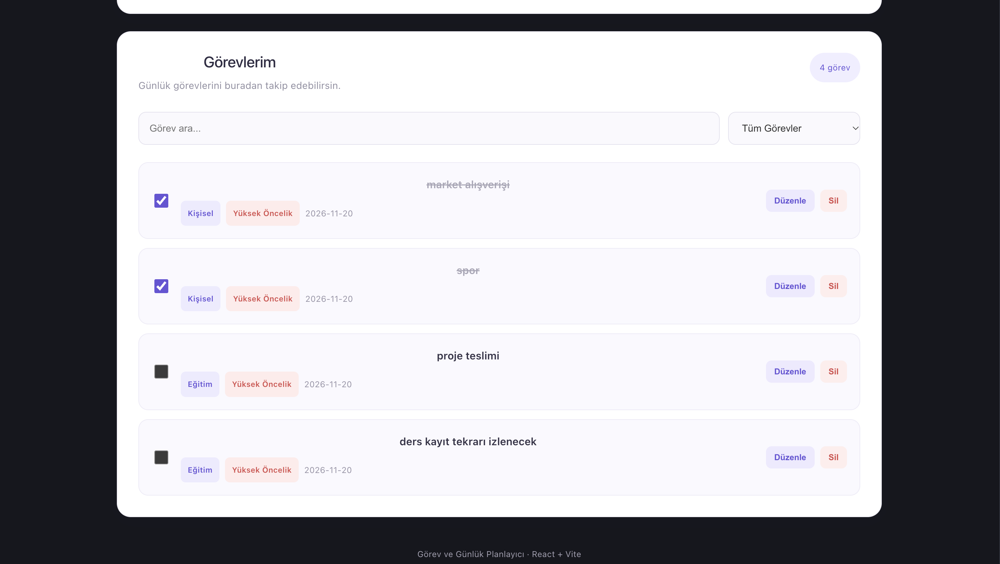
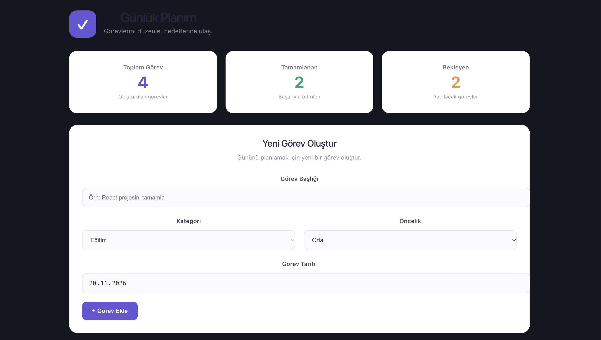

# Görev ve Günlük Planlayıcı

## Proje Hakkında

Görev ve Günlük Planlayıcı, kullanıcıların günlük işlerini düzenlemelerini, görevlerini takip etmelerini ve zamanlarını daha verimli yönetmelerini sağlayan web tabanlı bir görev yönetim uygulamasıdır.

Proje, **TNC Group Web Geliştirme; Yapay Zeka Eğitimi** kapsamında React ve Vite teknolojileri kullanılarak geliştirilmiştir.

Uygulama sayesinde kullanıcılar görev oluşturabilir, düzenleyebilir, silebilir, tamamlanan görevlerini işaretleyebilir ve görevlerini kategori, öncelik ve tarihe göre organize edebilir.

## Projenin Amacı

Bu projenin amacı, modern web geliştirme teknolojilerini kullanarak işlevsel, kullanıcı dostu ve mobil uyumlu bir görev planlama uygulaması geliştirmektir.

Proje kapsamında React bileşen yapısı, JavaScript ile etkileşimli uygulama geliştirme, CSS tasarımı ve LocalStorage ile veri saklama işlemleri uygulanmıştır.

Ayrıca yapay zekâ destekli yazılım geliştirme süreçleri deneyimlenmiştir.

## Projenin Özellikleri

- Yeni görev oluşturma
- Mevcut görevleri düzenleme
- Görevleri silme
- Görevleri tamamlandı olarak işaretleme
- Eğitim, İş ve Kişisel kategorileri
- Düşük, Orta ve Yüksek öncelik seçenekleri
- Görev tarihi belirleme
- Toplam görev sayısını görüntüleme
- Tamamlanan ve bekleyen görev istatistiklerini görüntüleme
- Görev arama ve filtreleme
- LocalStorage ile görevleri tarayıcıda saklama
- Mobil cihazlarla uyumlu kullanıcı arayüzü

## Kullanılan Teknolojiler

| Teknoloji | Kullanım Amacı |
|---|---|
| HTML5 | Web sayfasının yapısı |
| CSS3 | Tasarım ve mobil uyumluluk |
| JavaScript | Uygulama işlevleri |
| React | Bileşen tabanlı kullanıcı arayüzü |
| Vite | Geliştirme ve derleme ortamı |
| LocalStorage | Görev verilerinin saklanması |
| Visual Studio Code | Kod geliştirme ortamı |
| Git ve GitHub | Versiyon kontrolü ve kaynak kod paylaşımı |
| Netlify | Web uygulamasının yayınlanması |
| ChatGPT | Yapay zekâ destekli geliştirme |

## Proje Klasör Yapısı

```text
gorev-planlayici/
├── public/
│   ├── proje-ekran-goruntusu.png
│   └── proje-ekran-goruntusu2.png
├── src/
│   ├── App.jsx
│   ├── App.css
│   ├── index.css
│   └── main.jsx
├── index.html
├── package.json
├── package-lock.json
├── vite.config.js
└── README.md
```

## Kurulum

Projeyi bilgisayarınızda çalıştırmak için Node.js ve npm kurulu olmalıdır.

### 1. Projeyi GitHub üzerinden indirin

```bash
git clone https://github.com/tlntmrsena/gorev-planlayici.git
```

### 2. Proje klasörüne girin

```bash
cd gorev-planlayici
```

### 3. Gerekli paketleri yükleyin

```bash
npm install
```

### 4. Uygulamayı başlatın

```bash
npm run dev
```

Terminalde gösterilen yerel adresi tarayıcıda açın.

Genellikle:

http://localhost:5173/

### 5. Projeyi derleyin

```bash
npm run build
```

Bu komut uygulamanın yayınlanmaya hazır dosyalarını `dist` klasöründe oluşturur.

## Veri Saklama

Uygulamada görev verileri tarayıcının LocalStorage özelliği kullanılarak saklanmaktadır.

Kullanıcı görev eklediğinde, düzenlediğinde, sildiğinde veya tamamlandı olarak işaretlediğinde veriler otomatik olarak güncellenir.

Sayfa yenilendiğinde kaydedilmiş görevler korunur.

Veriler kullanılan tarayıcıya ve site adresine özeldir. Sunucu tabanlı bir veritabanı kullanılmamaktadır.

## Yapay Zekâ Kullanımı

Projenin geliştirilme sürecinde **OpenAI ChatGPT** yapay zekâ asistanından yararlanılmıştır.

Yapay zekâ aşağıdaki aşamalarda kullanılmıştır:

1. Proje fikrinin ve gereksinimlerinin planlanması
2. React bileşen yapısının oluşturulması
3. HTML, CSS ve JavaScript kodlarının geliştirilmesi
4. Görev ekleme, silme, düzenleme ve tamamlama işlevlerinin hazırlanması
5. LocalStorage veri saklama işlemlerinin geliştirilmesi
6. Kullanıcı arayüzü tasarımının ve mobil uyumluluğun düzenlenmesi
7. Karşılaşılan hata mesajlarının değerlendirilmesi ve çözülmesi
8. Git ve GitHub işlemlerinde rehberlik alınması
9. Netlify üzerinden yayınlama sürecinin planlanması
10. README dokümantasyonunun hazırlanması

Yapay zekâ tarafından önerilen kodlar geliştirme sürecinde uygulanmış, test edilmiş ve çalışan uygulamaya entegre edilmiştir.

Bu süreçte yapay zekâ, yazılım geliştirmeyi destekleyen bir yardımcı araç olarak kullanılmıştır.

## Proje Ekran Görüntüleri

Uygulamanın arayüzünü gösteren ekran görüntüleri aşağıda yer almaktadır.

### Ekran Görüntüsü 1



### Ekran Görüntüsü 2



## Canlı Uygulama

Görev ve Günlük Planlayıcı uygulaması Netlify üzerinden yayınlanmıştır.

**Web Sitesi:**

https://gorev-planlayici.netlify.app/

Uygulamaya bağlantı üzerinden tarayıcı aracılığıyla erişilebilir.

## GitHub

Projenin kaynak kodları, kullanılan teknolojiler ve dokümantasyon